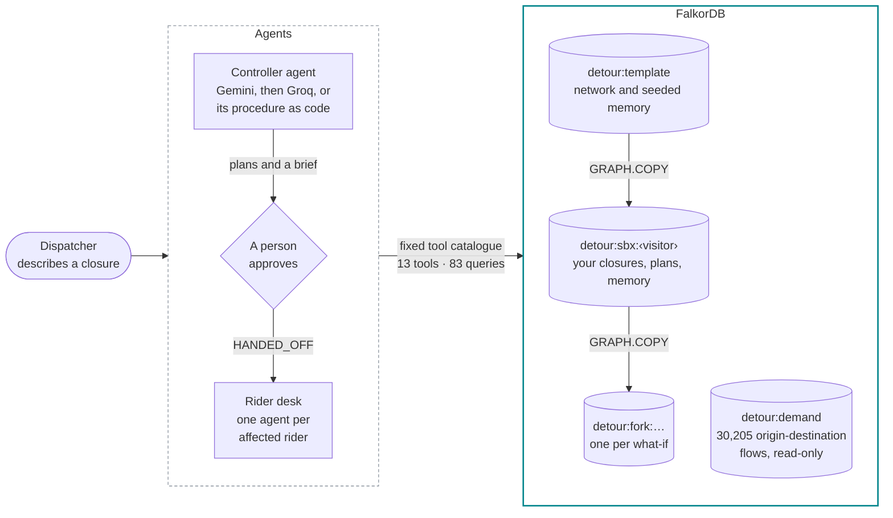
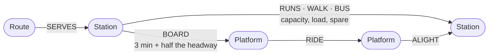
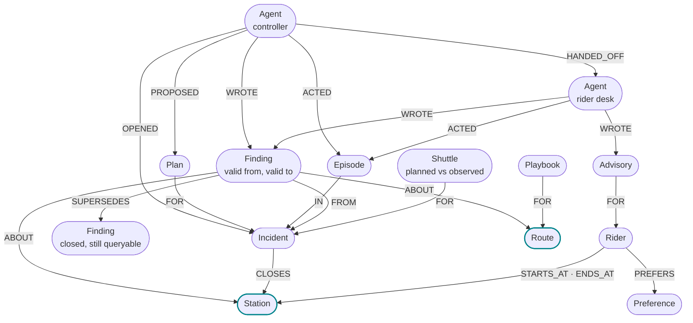

<p align="center">
  <a href="https://detour-orpin.vercel.app">
    
  </a>
</p>

<h1 align="center">Detour</h1>

<p align="center">
  <b>When a New York subway line breaks, Detour measures what the rest of the city can still carry.</b>
</p>

<p align="center">
  <a href="https://detour-orpin.vercel.app"></a>
  <a href="https://www.wemakedevs.org/hackathons/falkordb"></a>
  <a href="#why-a-graph"></a>
  <a href="#use-it-from-an-agent"></a>
</p>

<p align="center">
  <a href="https://detour-orpin.vercel.app/control?scenario=l-canarsie&run=1"><b>Control room</b></a> &nbsp;·&nbsp;
  <a href="https://detour-orpin.vercel.app/riders?rider=aisha"><b>Riders</b></a> &nbsp;·&nbsp;
  <a href="https://detour-orpin.vercel.app/memory"><b>Memory</b></a> &nbsp;·&nbsp;
  <a href="https://detour-orpin.vercel.app/brain"><b>Brain</b></a> &nbsp;·&nbsp;
  <a href="https://detour-orpin.vercel.app/proof"><b>Proof</b></a> &nbsp;·&nbsp;
  <a href="#use-it-from-an-agent"><b>MCP</b></a>
</p>

<br>

Agents work on a FalkorDB graph of the real subway, built from MTA open data. When a line breaks, they:

1. **Find** whose trips the closure breaks, including riders four stops away who never see it.
2. **Measure** what the open network can absorb with `algo.maxFlow`, and name the bottleneck (min cut).
3. **Test** shuttle-bus plans on forked copies of the graph.
4. **Tell** every remembered rider what to take instead, after a person approves.
5. **Explain** who owns what, who knows what and why each decision was made, from the agency's own documents, tickets, chats and decisions in the same graph.

Memory lives in the same graph: facts carry dates, and a fact that stops being true is closed, not deleted, so it changes the next answer.

| Track | Where to see it |
|:---|:---|
| **1 · Agents That Act on Connected Data** (primary) | The [control room](https://detour-orpin.vercel.app/control?scenario=l-canarsie&run=1) runs the controller on your own copy of the graph and shows every tool call with its Cypher |
| **2 · Agent Memory and Coordination** | On the [riders page](https://detour-orpin.vercel.app/riders?rider=aisha), a superseded fact changes a wheelchair user's route; the [memory page](https://detour-orpin.vercel.app/memory) shows every episode, finding and handoff |
| **3 · Company Brain** | The [brain page](https://detour-orpin.vercel.app/brain) answers who owns what, who knows what and why a decision was made, from the agency's teams, people, documents, tickets, chats and decisions in the same graph, with every answer citing its sources |

## What it finds on the L train

> [!NOTE]
> Every number in this table comes from tool calls on FalkorDB and is recomputed by an independent NetworkX program.

Close the L between Bedford Av and 8 Av at 8 a.m. on a weekday:

| Question | What the graph says |
|:---|:---|
| Whose trips cross the closure? | **23,445** riders an hour (10,142 board within one stop of it; 14,713 within four) |
| Where do they go if nobody steers them? | 4 G segments run at **190 to 244%** of capacity; 4,689 riders have no open path |
| What can the open network carry if riders spread perfectly? *(max flow)* | **17,167 of 18,432** riders an hour toward Manhattan (93%) |
| Where is the bottleneck? *(min cut)* | **1 Av**: its only rail links are the closed L, so no spare capacity elsewhere reaches its riders |
| Does a shuttle help? *(tested on a fork)* | 1 Av ↔ Astor Pl: riders with no path 4,689 → **623**; max-flow shortfall 1,266 → **315**. A two-leg plan does no better with 18 more buses |
| Did memory change the plan? | The June bus bridge carried 79% of plan, so the controller adds **27%** more buses |

With the shuttle, fastest-path overflow rises (24,078 → 28,762) because 4,066 more riders can now travel, so the rider desk steers them onto lines with room. The Lexington express and Cranberry Street Tunnel closures come out differently: the open network absorbs everyone, so the controller proposes steering riders with no buses at all.

## See it run

<p align="center">
  <a href="https://detour-orpin.vercel.app/control?scenario=l-canarsie&run=1">
    
  </a>
  <br>
  <sub>The controller on the L closure: each tool call streams into the trace, the night map shows its evidence, and the playback bar can replay any step.</sub>
</p>

## On screen

| Screen | What you can do |
|:---|:---|
| **Home** | Follow the L closure in six chapters on one sticky night map: who it hits, where they go, what max flow says the network can carry, the min cut, the shuttle tested on a fork, the riders rerouted. Every number comes from the run recorded on FalkorDB |
| **Control room** | Close a line and watch the controller's tool calls stream in with their Cypher. Scrub, step or replay the run at 1×, 2× or 4×, and link straight to a step with `?step=` |
| **Riders** | Remembered riders and their routes. Report an elevator fixed and watch memory change a wheelchair user's route. With the database down, each rider shows the route the recorded run found |
| **Memory** | Memory over time: each fact's validity window, closed facts and what replaced them, incidents and agent steps |
| **Brain** | Ask who owns a station or line, who knows it best, why a decision was made, or what changed this week; each answer cites the documents, tickets, chats, decisions and findings it came from, with the Cypher behind it. Paste a chat message, ticket or note to add it: it is linked to what it names, and an outage is filed with its owner. Your conversation is remembered in your graph |
| **Proof** | FalkorDB and NetworkX side by side, the concurrency benchmark, and every query |
| **Every page** | <kbd>Ctrl</kbd>/<kbd>⌘</kbd> <kbd>K</kbd>, or the search icon on a phone, opens a command palette for any closure, rider, page or proof check; the theme switch spreads paper or night service from where you click and remembers it |

## How it works



- **The model never writes Cypher.** It picks from a fixed catalogue of typed tools. Each returns one of four answer shapes (answered, from memory, not in the graph, unknown name), a one-line summary, the data, and the exact queries it ran with their timings, which the control room shows step by step.
- **Three run modes, labeled in the interface.** *Live*: a free model (Gemini, then Groq) chooses the tools. *Scripted*: when the free quota is spent, the controller's procedure runs as code with the same tools on your graph. *Recorded*: when the database is unreachable, a run recorded on FalkorDB plays back.
- **Every visitor gets a graph.** The first request copies the template into `detour:sbx:<visitor>`; what-if forks are copied from that and deleted after use. Visitors never write to the template, and the demand graph is shared and read-only.

## Why a graph

Each step is a graph question that a table or a vector store answers badly:

| Question | How the graph answers it |
|:---|:---|
| **Whose trips cross the break?** | Demand edges carry the segment ids of their 8 a.m. path; stations upstream are found hop by hop over `RUNS` |
| **What can the rest of the network carry?** | `algo.maxFlow` from a super source to a super sink over spare capacity, per direction of travel, on a fork without the closed segments. The min cut comes from the residual graph |
| **Where do riders actually go?** | `algo.SPpaths` over a platform layer (board, ride, alight, walk, bus), so waits and transfers are priced the way the baseline assignment prices them |
| **What did we learn last time?** | Findings hang off the same `Station` and `Route` nodes, so recall is a match from the stations an agent is about to touch |

## Graph data model

**The network** (`detour:template`, copied into every visitor's sandbox). Max flow runs on the station-to-station links; shortest paths add the platform layer, so waits and transfers have a price.



**Memory and coordination** (in each sandbox). Everything an agent does or learns hangs off the same `Station` and `Route` nodes it reasons about.



The demand graph (`detour:demand`, shared and read-only) holds one `DEMAND` edge per station pair: 30,205 pairs, 404,040 of 446,230 riders at 8 a.m. Forks add `(:Hub {id: 'SRC_F' | 'SNK_F' | …})` and `FLOW {kind, spare, refs}` edges: spare capacity summed per corridor, because `algo.maxFlow` takes one relationship type and no parallel edges. The full spec both implementations follow is [docs/model.md](docs/model.md).

<details>
<summary><b>Every label and property</b></summary>

<br>

**Network** (`detour:template`, copied per visitor)

```cypher
(:Station {id, name, label, lat, lon, loc, borough, ada, routes, entries})
(:Route {id, short, longName, color})-[:SERVES]->(:Station)

// 1,459 scheduled segments
(:Station)-[:RUNS {eid, route, tph, minutes, baseMinutes, capacity, load, spare, closed}]->(:Station)
// 190 walking links under 400 m
(:Station)-[:WALK {wid, meters, minutes, capacity, spare}]->(:Station)
// BOARD minutes = 3 + half the headway
(:Station)-[:BOARD {minutes}]->(:Platform {id, station, route})
(:Platform)-[:RIDE {eid, minutes, closed}]->(:Platform)-[:ALIGHT {minutes: 0}]->(:Station)
// published shuttle legs
(:Station)-[:BUS {bid, plan, capacity, minutes, busesPerHour}]->(:Station)
```

**Demand** (`detour:demand`, shared and read-only)

```cypher
// 30,205 pairs, 404,040 of 446,230 riders at 8 a.m.
(:Station)-[:DEMAND {riders, minutes, via: [eid], walks: [wid]}]->(:Station)
```

**Memory and coordination** (in each sandbox)

```cypher
(:Agent)-[:WROTE]->(:Finding {id, text, kind, confidence, validFromMs, validToMs})-[:ABOUT]->(:Station | :Route)
// a changed fact gets an end date and a successor
(:Finding)-[:SUPERSEDES]->(:Finding)
(:Finding)-[:FROM]->(:Incident)
(:Agent)-[:OPENED]->(:Incident {id, routes, stretch, closedEids, status, displaced,
                                overflow, stranded, required, absorbed, unmet})-[:CLOSES]->(:Station)
(:Agent)-[:ACTED]->(:Episode {tool, outcome, summary, queries, ms, atMs})-[:IN]->(:Incident)
(:Agent)-[:PROPOSED]->(:Plan {id, legs, vehicles, strandedBefore, strandedAfter,
                              unmetBefore, unmetAfter, …})-[:FOR]->(:Incident)
(:Agent)-[:HANDED_OFF {plan, incident, note, atMs}]->(:Agent)
(:Shuttle {busesPerHour, planned, observed})-[:FOR]->(:Incident)
(:Playbook {title, steps, uses, lastUsedMs})-[:FOR]->(:Route)
(:Rider {id, name, persona, stepFree, usualEids})-[:STARTS_AT|ENDS_AT]->(:Station)
(:Rider)-[:PREFERS {validFromMs, validToMs}]->(:Preference {key, value})
(:Agent)-[:WROTE]->(:Advisory {text, minutes, route, stepFree, atMs})-[:FOR]->(:Rider)
```

</details>

## The queries it depends on

All 83 queries and graph commands are listed with their labels on the [proof page](https://detour-orpin.vercel.app/proof#cypher). The two that carry the reasoning:

```cypher
// On a fork without the closed segments: spare capacity summed per corridor, then max flow
MATCH (a:Station)-[r]->(b:Station) WHERE type(r) IN $kinds
WITH a, b, sum(r.spare) AS spare,
     collect(CASE type(r) WHEN 'RUNS' THEN 'R' + toString(r.eid)
                          WHEN 'WALK' THEN 'W' + toString(r.wid)
                          ELSE 'B' + toString(r.bid) END) AS refs
CREATE (a)-[:FLOW {spare: spare, kind: 'NET', refs: refs}]->(b)

MATCH (src:Hub {id: $src}), (snk:Hub {id: $snk})
CALL algo.maxFlow({sourceNodes: [src], targetNodes: [snk],
                   relationshipTypes: ['FLOW'], capacityProperty: 'spare'})
YIELD maxFlow, edges, edgeFlows
RETURN maxFlow,
       [e IN edges | [e.kind, startNode(e).id, endNode(e).id]] AS es,
       edgeFlows AS flows
```

```cypher
// Every displaced pair on its fastest open path, in one query
UNWIND $pairs AS p
MATCH (a:Station {id: p.o}), (b:Station {id: p.d})
CALL algo.SPpaths({sourceNode: a, targetNode: b,
                   relTypes: ['BOARD', 'RIDE', 'ALIGHT', 'WALK', 'BUS'], weightProp: 'minutes'})
YIELD path, pathWeight
RETURN p.o AS o, p.d AS d, pathWeight AS minutes,
       [r IN relationships(path) WHERE type(r) = 'RIDE' | r.eid] AS eids
```

<details>
<summary><b>Four more: who is hit, upstream stations, forks and recall</b></summary>

<br>

```cypher
// Whose trips cross the closure (demand graph)
MATCH (o:Station)-[d:DEMAND]->(x:Station)
WHERE any(e IN d.via WHERE e IN $closed)
RETURN o.id AS o, x.id AS d, d.riders AS riders, d.via AS via

// Stations k stops upstream, one hop per query
// (variable-length paths over parallel edges time out)
MATCH (o:Station)-[:RUNS]->(t:Station)
WHERE t.id IN $frontier AND NOT o.id IN $seen
RETURN DISTINCT o.id AS id

// A what-if fork per call
GRAPH.COPY detour:sbx:<visitor> detour:fork:<visitor>:<label>

// Memory: recall from the stations and routes an agent is about to touch
MATCH (f:Finding)-[:ABOUT]->(n)
WHERE (n:Station AND n.id IN $stations) OR (n:Route AND n.id IN $routes)
WITH DISTINCT f
OPTIONAL MATCH (f)-[:FROM]->(i:Incident)
RETURN f.id AS id, f.text AS text, f.validFromMs AS validFromMs,
       f.validToMs AS validToMs, i.id AS incident
```

</details>

## Track 2: memory you can watch change an answer

On the [riders page](https://detour-orpin.vercel.app/riders?rider=aisha), Aisha uses a wheelchair. Memory says the elevator to the L platform at Myrtle-Wyckoff Avs has been out since Oct 14, so her step-free route skips the faster L and takes the M (33 min). Report the elevator fixed: the rider desk writes a new finding that supersedes the outage (the old one gets an end date and stays queryable), and her next route is the L (24 min).

<p align="center">
  
</p>

The write that changes her route:

```cypher
// A fact that stopped being true is closed and linked to its successor, never deleted
MATCH (old:Finding {id: $old}), (f:Finding {id: $id})
WHERE old.validToMs IS NULL
SET old.validToMs = timestamp()
CREATE (f)-[:SUPERSEDES]->(old)
```

| Memory | How it lives in the graph |
|:---|:---|
| **Episodic** | Every tool call becomes an `Episode` linked to its incident; the [memory page](https://detour-orpin.vercel.app/memory) draws every fact over its validity window on a timeline |
| **Semantic, with time** | Findings carry `validFromMs`/`validToMs` and provenance (who wrote it, from which incident) |
| **Procedural** | Playbooks per route; past shuttles keep planned against observed riders, and the controller sizes new bus plans by the worst ratio it remembers |
| **Shared state and handoffs** | Approval writes `HANDED_OFF` from the controller to the rider desk, which runs one agent per affected rider concurrently |
| **Persistent conversation history** | Every question and answer is a `Turn` node in the visitor's graph, chained by `NEXT`, the question linked to the stations and lines it mentions and the answer to the nodes it cites. The rider desk and the brain read their history back from the graph, so a returning visitor's conversation continues (visitor graphs are kept for three days) |
| **Per tenant, under load** | One graph per visitor. 48 reader and 6 writer agents across 6 tenant graphs sustained 7,195 reads and 719 writes a second (p95 15.5 ms and 17.1 ms), 0 errors, and a closure in one tenant was invisible in the other five |

## Track 3: a company brain for the agency

The agency that runs the response lives in the same graph as the subway it runs. Its 7 teams and 10 people, 7 documents (after-action reports, playbooks, a procedure, a policy, notices), 3 maintenance tickets, 6 chat messages and 4 decisions are nodes linked to the same `Station`, `Route`, `Incident`, `Finding` and `Playbook` nodes the agents use. The agency side is sample data, labeled as such; the subway is real.

On the [brain page](https://detour-orpin.vercel.app/brain), ask:

| Question | What the graph does |
|:---|:---|
| *Who owns the Myrtle-Wyckoff elevator outage?* | Resolves the station with the full-text index, then follows `OWNS` and `MAINTAINS` to teams and their people, the open ticket and its assignee, and ranks who knows it best by the records they wrote, filed, posted or were assigned |
| *Why do L tube bus bridges get 27% more buses?* | Finds the decision, then walks `BASED_ON` to the earlier decision, the chat message and the finding it rests on, and `SOURCED_FROM` from that finding back to the after-action report and the ticket: two hops to the original sources |
| *What changed in the last 7 days?* | Every dated change in the graph: findings learned or closed, tickets opened or resolved, decisions made or lifted, documents, chats and published plans |
| *Is the Myrtle-Wyckoff L elevator working?* | Searches documents, tickets, chats, decisions and findings, and leads with the ticket's status |

Knowledge stays current. Report the Myrtle-Wyckoff elevator fixed on the riders page and three things change in one graph: the outage finding is superseded, ticket EE-1207 resolves and cites the new finding, and the decision to route step-free riders around that platform is lifted. Ask the brain what changed, and those are the first answers.

New knowledge comes in, and work goes out to its owner. Paste a chat message, ticket or note into **Add to the brain** and it becomes a node linked to the stations, lines and people it names (station names are matched with the longest name winning, and a name several stations share is settled by the line the text mentions). An elevator outage files a ticket with the maintenance team's lead, or joins the platform's open ticket instead of duplicating it, and writes the outage to memory, so step-free routes avoid that platform at once. A message saying it works again resolves the ticket and lifts the decisions that rested on it. Your own questions and answers are kept as conversation turns, so the brain shows them when you come back.

| Pasted into the brain | What the graph does |
|:---|:---|
| *Elevator to the A platform at Jay St-MetroTech is stuck between floors.* | Links the message to Jay St-MetroTech and the A, files ticket EE-1208 with Gloria Méndez (Elevator and Escalator Maintenance), and writes the outage to memory |
| *Still stuck: the A platform elevator at Jay St-MetroTech has not moved.* | Adds the report to EE-1208 instead of filing a second ticket |
| *Signal problem on the G near Metropolitan* (as a ticket) | Resolves "Metropolitan" to Metropolitan Av/Lorimer St by the G and assigns it to the G's planner, Priya Raman |
| *Myrtle-Wyckoff L platform elevator is back in service.* | Closes the outage in memory, resolves EE-1207 and lifts the step-free routing decision |

```cypher
// Why a decision was made, two hops back to where its evidence came from
MATCH (d:Decision {id: $id})-[:BASED_ON]->(f:Finding)-[:SOURCED_FROM]->(s)
RETURN f.id AS finding, collect(DISTINCT s.id) AS sources
```

Every answer is a list of numbered source nodes with who wrote each one, their team and the date, and the answer cites them as [1], [2]. A free model writes the answer when quota allows; otherwise the standard procedure picks the tool from the question and answers in templated words, labeled as such.

## Proof

| Check | Result |
|:---|:---|
| Max flow, FalkorDB `algo.maxFlow` vs NetworkX Edmonds-Karp | Agree in all 6 direction groups of the 3 closures |
| Riders hit by distance from the L closure | Agree at every depth, 0 to 6 stops |
| Closed segments per scenario | Identical sets |
| Concurrency (FalkorDB 4.22.1) | 7,195 reads/s and 719 writes/s, 0 errors, tenant isolation held |
| Unit tests | 93 Vitest tests, including the control room's state and playback on recorded runs, the story's chapters, the memory timeline's layout on desktop and phone, the command palette's search, how tool summaries read, waiting out a model's rate limit, handing a spent daily quota to the standard procedure, the eval grader, the brain's question routing and the integrity of its sample records, and how pasted text is read: stations, lines, people, an outage or a fix |
| End-to-end tests | 15 Playwright tests, each on desktop and phone: the control flow and playback, the riders page with the database down, the memory timeline, the command palette from the keyboard and on a phone, the brain tracing a decision and naming a ticket's owner, and axe accessibility checks on every page, after a run and after approval, in light and dark |
| Lighthouse, mobile (every page) | Performance 96 to 98; accessibility, best practices and SEO 100 |

<p align="center">
  
</p>

## Screens

<p align="center">
  
  <br>
  <sub><b>The story.</b> The home page tells the L closure chapter by chapter over one sticky night map; here the G runs at 244% of capacity.</sub>
</p>

<table>
  <tr>
    <td width="37%" rowspan="2" align="center">
      
      <br>
      <sub><b>On a phone, at night.</b> The shuttle chapter: a close-up of the bridge above its card.</sub>
    </td>
    <td width="63%">
      
      <br>
      <sub><b>Control room.</b> The G overloads in red, max flow moves 17,167 of 18,432 riders an hour, and the trace shows every tool call with its Cypher.</sub>
    </td>
  </tr>
  <tr>
    <td width="63%">
      
      <br>
      <sub><b>After approval.</b> Two shuttle plans tested on forks, the recommended one published, and a rider agent routing Tomás around the break.</sub>
    </td>
  </tr>
</table>

<p align="center">
  
  <br>
  <sub><b>Memory over time.</b> Every fact over its validity window; a closed fact keeps its window, and the last three weeks are drawn wider.</sub>
</p>

## Use it from an agent

The same tools are served over MCP (Streamable HTTP) at `https://detour-orpin.vercel.app/api/mcp`. `assess_closure` runs on a private copy of the graph, so clients never see each other's closures.

```bash
claude mcp add --transport http detour https://detour-orpin.vercel.app/api/mcp
```

| Tool | What it does |
|:---|:---|
| `resolve_places` | Resolves station and route names to graph ids, with ambiguous candidates or unknown names |
| `route_trip` | The fastest route at 8 a.m. on a weekday; `step_free` keeps every boarding and exit accessible and skips platforms with a remembered elevator outage |
| `recall_memory` | Dated facts, past incidents with planned versus observed shuttle capacity, and playbooks for the given routes and stations |
| `assess_closure` | Closes routes between two stations on a private copy of the graph, then reports riders hit by distance, overflow, max flow with the min cut and, optionally, a shuttle plan (about 4 seconds; 30 an hour per client) |

## Run it locally

Requirements: Node 22+, pnpm 11, a FalkorDB instance (FalkorDB Cloud's free tier, or `docker run -p 6379:6379 falkordb/falkordb`), and optionally a free Gemini or Groq key.

```bash
pnpm install
cp .env.example .env.local
# in .env.local: FALKORDB_URL, and GOOGLE_GENERATIVE_AI_API_KEY or GROQ_API_KEY for live agents
pnpm seed    # loads the network, demand and memory into FalkorDB (about a second)
pnpm dev     # http://localhost:3000
```

From a clean checkout, install, type check, unit tests and a production build take about a minute (62 s with a warm pnpm cache). The built network is committed in `data/nyc/`; to rebuild it from MTA sources, run `pnpm fetch:data && pnpm build:data`.

| Command | What it checks |
|:---|:---|
| `pnpm test` | Unit tests (Vitest) |
| `pnpm typecheck`, `pnpm lint` | Types and lint |
| `pnpm test:e2e` | Playwright on desktop and phone; set `BASE_URL` to test a deployment |
| `pnpm verify` | The NetworkX verifier (needs [uv](https://docs.astral.sh/uv/)) |
| `pnpm ci:scenarios` | Every tool on all three closures against FalkorDB, compared with NetworkX |
| `pnpm ci:bench` | The concurrency and tenant-isolation benchmark |

**Stack:** Next.js 16 (App Router, Cache Components), React 19, Tailwind 4, TypeScript, FalkorDB 4.22 via `falkordb` 6.8, Vercel AI SDK 7 with Gemini and Groq, and `mcp-handler`. Deployed on Vercel.

## Data

[MTA GTFS static](http://web.mta.info/developers/data/nyct/subway/google_transit.zip) (weekday trains departing 08:00 to 08:59 give trains per hour and capacity), [MTA Subway Stations](https://data.ny.gov/d/39hk-dx4f) and [Stations and Complexes](https://data.ny.gov/d/5f5g-n3cz) (accessibility), and the [MTA Subway Origin-Destination Ridership Estimate: 2025](https://data.ny.gov/d/y2qv-fytt) (a Wednesday in October 2025, 8 a.m.). Assumptions are listed on the [proof page](https://detour-orpin.vercel.app/proof#data). The remembered riders, past incidents and playbooks are example data and labeled as such. Detour is not affiliated with the MTA.

## AI assistance

Detour was built with [Claude Code](https://claude.com/claude-code), Anthropic's coding agent, as a pair programmer: it did much of the research, design, code, tests and documentation under my direction. At runtime the agents use free-tier Gemini and Groq models. The graph model, queries and architecture are documented above, and every number the agents report is checked by the NetworkX verifier rather than by a language model.
