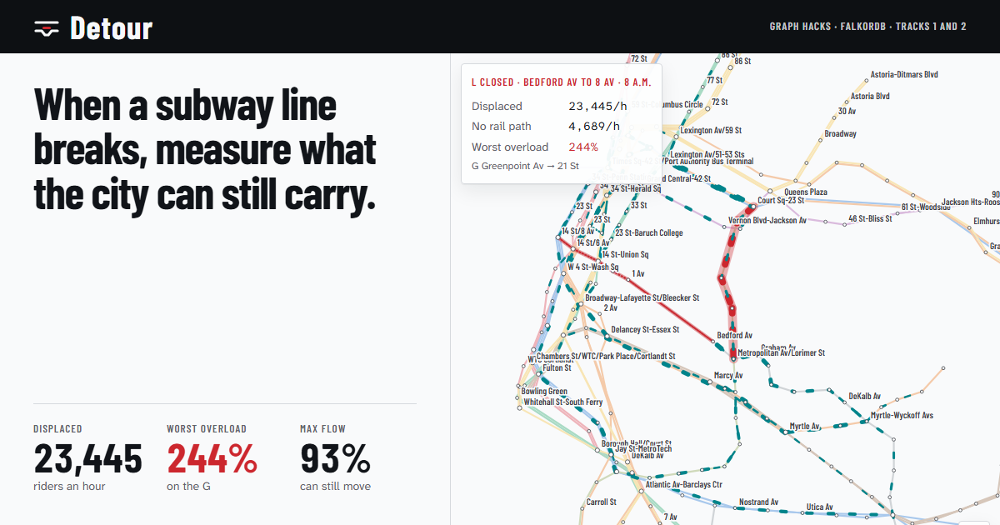
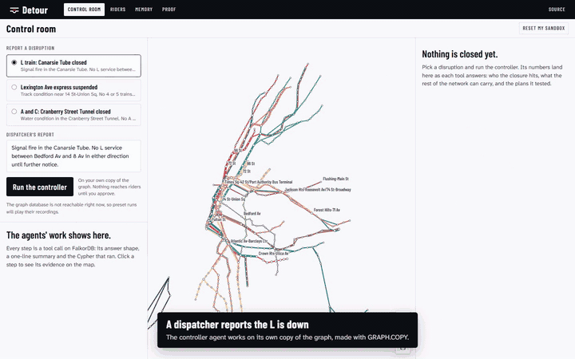
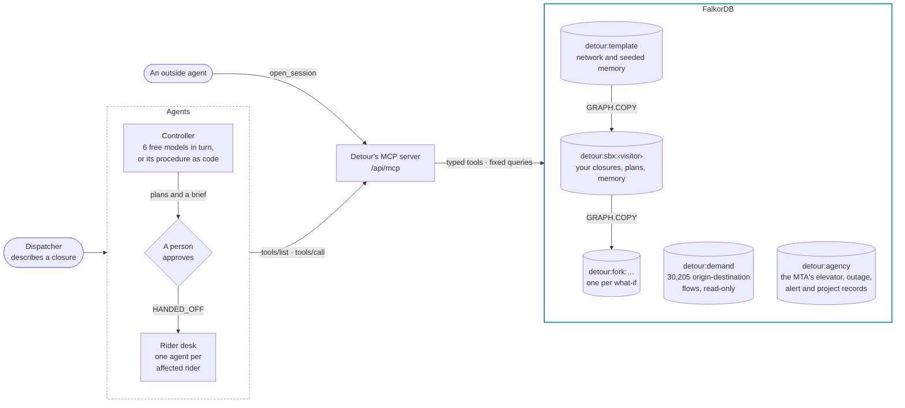
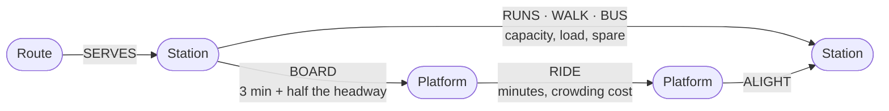
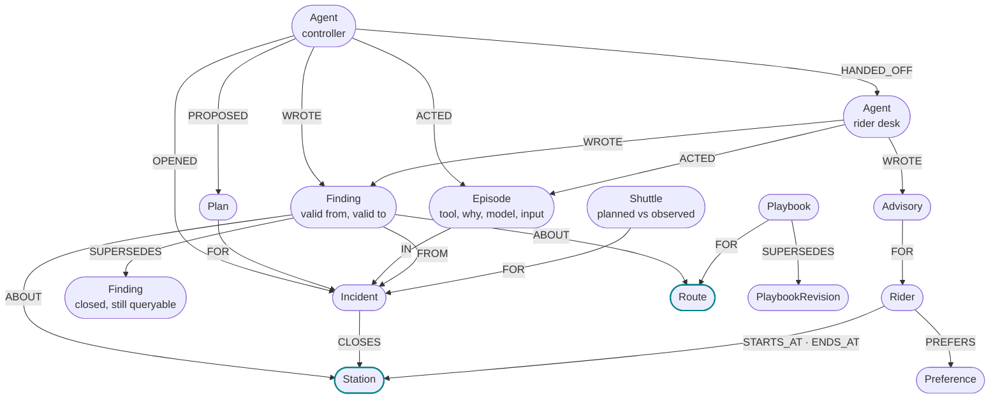
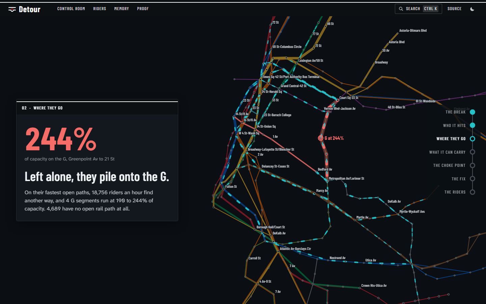
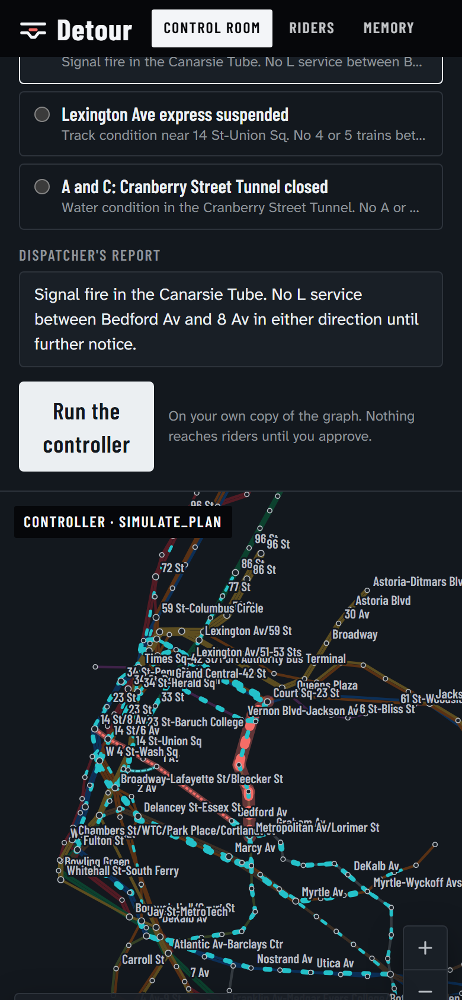
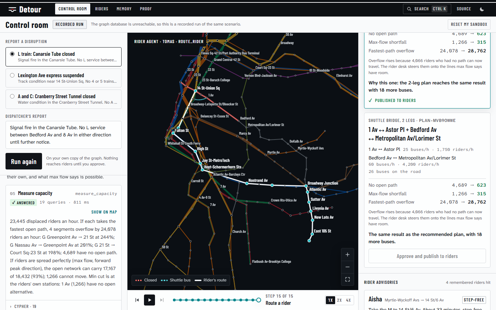
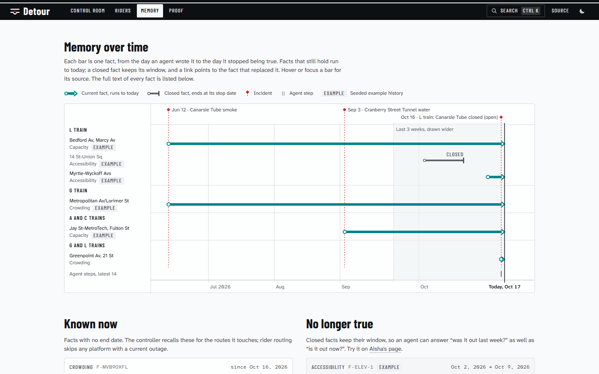

<p align="center">
  <a href="https://detour-orpin.vercel.app">
    
  </a>
</p>

<h1 align="center">Detour</h1>

<p align="center">
  <b>When a New York subway line breaks, Detour measures what the rest of the city can still carry.</b>
</p>

<p align="center">
  <a href="https://detour-orpin.vercel.app"></a>
  <a href="https://www.wemakedevs.org/hackathons/falkordb"></a>
  <a href="#use-it-from-an-agent"></a>
  <a href="CLAIMS.md"></a>
  <a href="#evidence"></a>
</p>

<p align="center">
  <a href="https://youtu.be/11xHEZ07rlw"></a>
  &nbsp;
  <a href="https://dev.to/saudsatopay/i-shut-down-the-l-train-in-a-graph-max-flow-min-cut-and-ai-agents-on-the-new-york-subway-40g7"></a>
</p>

<p align="center">
  <a href="https://detour-orpin.vercel.app/control?scenario=l-canarsie&run=1"><b>Control room</b></a> &nbsp;·&nbsp;
  <a href="https://detour-orpin.vercel.app/riders?rider=aisha"><b>Riders</b></a> &nbsp;·&nbsp;
  <a href="https://detour-orpin.vercel.app/memory"><b>Memory</b></a> &nbsp;·&nbsp;
  <a href="https://detour-orpin.vercel.app/brain"><b>Brain</b></a> &nbsp;·&nbsp;
  <a href="https://detour-orpin.vercel.app/proof"><b>Proof</b></a> &nbsp;·&nbsp;
  <a href="#use-it-from-an-agent"><b>MCP</b></a>
</p>

<br>

> [!IMPORTANT]
> **The entry submitted before the deadline is [v1.0.0](https://github.com/SaudSatopay/detour/tree/v1.0.0)**, tagged on October 18 at 23:20 IST (the deadline was 23:59 IST), with [its README](https://github.com/SaudSatopay/detour/blob/v1.0.0/README.md). This page and the live site describe the current version, which adds work done on October 19, after the deadline: see [After the deadline](#after-the-deadline).

Agents work on a FalkorDB graph of the real subway, built from MTA open data. When a line breaks, they:

1. **Find** whose trips the closure breaks, including riders four stops away who never see it.
2. **Measure** what the open network can absorb with `algo.maxFlow`, certify the answer, and name what limits it.
3. **Test** shuttle-bus plans on forked copies of the graph.
4. **Tell** every remembered rider what to take instead, routed around the segments that overflow, after a person approves.
5. **Explain** who maintains what, what is broken right now and why each decision was made, from the MTA's own elevator, outage and alert records in the same graph.

The agents find their tools on Detour's own MCP server, the same one an outside agent connects to, and choose them toward a goal; when the model says why it makes a call, the trace shows that sentence with the call. Memory lives in the same graph: facts carry dates, and a fact that stops being true is closed, not deleted, so it changes the next answer.

## For judges: 60 seconds

1. **[Report Aisha's elevator fixed](https://detour-orpin.vercel.app/riders?rider=aisha)** first. One memory write closes the old fact, resolves the ticket, lifts the decision that rested on it, and her step-free route changes from the M (33 min) to the L (24 min). (After step 2 closes the L in your sandbox, her route stays on the M whatever memory says.)
2. **[Run the L closure](https://detour-orpin.vercel.app/control?scenario=l-canarsie&run=1).** A free model lists its tools over MCP and works through the closure. Each step shows the arguments it passed, the model's sentence before it when it wrote one, and the Cypher, time and rows behind the answer; each figure in the final brief is then looked up in the tool results, a check that the figures exist there, not that they are used correctly. When the day's free models are spent, the standard procedure carries on from the last step and the trace says so.
3. **[Ask the brain](https://detour-orpin.vercel.app/brain)** *"Is the elevator at Times Sq-42 St working?"* The answer quotes the MTA's own feed and says when it was read.
4. **[Open the proof](https://detour-orpin.vercel.app/proof)**, or re-measure everything yourself: `pnpm judge` checks the README's 16 headline claims against FalkorDB and an independent NetworkX program, and fails loudly on any mismatch ([CLAIMS.md](CLAIMS.md)).

## Evidence

Every result below is committed with the script that produced it; the proof page shows each one with its method.

| What was tested | Result |
|:---|:---|
| **The agent with the graph against the same model without it** (101 held-out questions, split before any run, plus a rules-only floor) | So far on 28 held-out questions per arm, mostly about the three demo closures: with the graph **93%** (26 of 28); the same free model with no data at all **7%** (2 of 28). A rules router written against the question templates answers 101 of 101, so on these questions the model adds no accuracy over plain rules. The run goes on as the free models' daily quotas allow ([Agent vs no graph](https://detour-orpin.vercel.app/proof#agent-eval)) |
| **48 random closures held out** (seeded, 25 lines, 2 to 6 segments) | FalkorDB and NetworkX agree on closed segments, displaced riders, max flow, riders with no path, cut-off stations and headroom in **48 of 48** |
| **Max flow, certified on every run** | Each answer is checked for feasibility and optimality before use. FalkorDB 4.22.1 returns 300 where the exact answer is 453 on a published 11-edge network, and a wrong flow on 13 of 100 random node-split networks; the certificate catches all of them, and none occurred on the subway |
| **Memory on real MTA elevator records** (a replay of the memory policy in TypeScript, not FalkorDB, over 9,360 held-out decisions, Jan to Aug 2026) | Picks the unit that ran more **66.3%** of the time (95% CI 61.3 to 72.4), against 61.8% for a memory that keeps every record forever and 50.2% with none |
| **Step-free routing with memory off and on** (on FalkorDB; trips chosen because their memory-off route uses a platform whose elevator is out) | Routes through an out-of-service elevator: **100% → 0%**; 41% of those trips then have no step-free route at all |
| **Procedural memory** (leave-one-out over 32 incidents, 30 of them synthetic, on FalkorDB) | Bus-sizing error **255 → 107** riders an hour |
| **Concurrency** | 100 writers racing on one fact leave exactly **1** current; 48 readers and 6 writers sustain 7,195 reads and 719 writes a second, 0 errors, tenants isolated |
| **The company brain on real MTA records** (769 held-out template questions, the brain's tools without a model) | Graph tools **100%** exact match, against 84.4% for keyword retrieval and 83.1% for the latest snapshot alone; one fix, full station names read before partial ones, came after a held-out run that scored 99.4% ([caveats](https://detour-orpin.vercel.app/proof#brain-eval)) |
| **A recorded live run** ([data/replays/l-canarsie-control.ndjson](data/replays/l-canarsie-control.ndjson)) | `gemini-flash-lite-latest` found 10 tools over MCP and made 8 calls in 19.5 s; **23 of 23** figures in its brief passed the check of the time. The stricter check now in use (figures of 10 or more, percentages only where a tool stated them) finds all 30 of its figures, and passes 8 of 400 random figures and 13 of 300 random percentages against the same results (`pnpm eval:grounding`). It tested only a two-leg plan, which leaves the same 623 riders with no path and the same 315 max-flow shortfall as one leg alone, with more buses. Recorded before the bus counting was fixed, so its bus loads are overstated |
| **Tests** | 231 unit tests, 19 Playwright tests on desktop and phone (axe accessibility on every page, after a run and after approval, in light and dark), Python verifier tests |

## After the deadline

Everything in this list was built on October 19, after the submission deadline, and is not part of the entry submitted as [v1.0.0](https://github.com/SaudSatopay/detour/tree/v1.0.0) ([every change since](https://github.com/SaudSatopay/detour/compare/v1.0.0...main)):

- **Agents.** The app's own agents list and call their tools over Detour's MCP server (at v1.0.0 the server offered four tools to outside agents). A chain of free Gemini and Groq models, a goal-driven controller prompt, the check of the brief's figures, and a handover to the standard procedure from the last step.
- **Proof.** The max-flow certificate with a Dinic fallback, 48 held-out closures against NetworkX, headroom, [CLAIMS.md](CLAIMS.md) and `pnpm judge`, and the held-out agent eval.
- **Memory.** Procedural memory that learns from what shuttles carried, rider routing around crowded segments, and the memory evals.
- **Company brain.** The MTA's real elevator, outage, alert, complaint and project records, and their held-out eval. At v1.0.0 the brain held the sample agency's records only.
- **Operations.** Fixes for a free database that filled up, went down under load and once came back empty, and recorded fallbacks for the brain.

## The judging guidance, point by point

| What the organisers' guide asks for | In Detour |
|:---|:---|
| The graph does work the agent could not do without it | Max flow and its certificate, shortest paths over a platform layer, and what-ifs on graph copies; measured against the same model with no graph ([Evidence](#evidence)) |
| The same question at depth 1 and depth 4 | Closing the L: **10,142** riders board within one stop of it, **14,713** within four |
| Say when something is not in the graph | Every tool answers in one of four shapes: answered, from memory, not in the graph, unknown name |
| Tool traces: arguments, timing, rows | Every step in the control room shows the arguments the agent passed, the Cypher, milliseconds and rows |
| The model never writes Cypher | A fixed catalogue of typed tools; every query is listed on the [proof page](https://detour-orpin.vercel.app/proof#cypher) |
| Tool selection through MCP | The controller and rider desk list their tools on Detour's MCP server (`tools/list`) and call them there (`tools/call`) |
| Names checked against the graph | `resolve_places` first, through a full-text index; two stations that match about equally well come back as a choice to make by line |
| Memory as nodes, read first | Findings with validity windows hang off the same `Station` and `Route` nodes; `recall_memory` runs before planning |
| One graph per tenant | `GRAPH.COPY` gives every visitor and every MCP session a sandbox, and every what-if a throwaway fork |
| Paths with answers | Routes come leg by leg; a decision is traced two hops back to the records it rests on |

| Track | Where to see it |
|:---|:---|
| **1 · Agents That Act on Connected Data** | The [control room](https://detour-orpin.vercel.app/control?scenario=l-canarsie&run=1): a model choosing tools over MCP, certified max flow, plans tested on forks, a grounded brief |
| **2 · Agent Memory and Coordination** | The [riders page](https://detour-orpin.vercel.app/riders?rider=aisha) and [memory page](https://detour-orpin.vercel.app/memory): memory that changes routes, playbooks that learn from what shuttles carried, and memory measured on real records |
| **3 · Company Brain** | The [brain page](https://detour-orpin.vercel.app/brain): the MTA's real elevators, outages, alerts and projects in one graph with the agency's people and decisions, every answer quoting its sources |

<p align="center">
  <a href="#see-it-run">See it run</a> &nbsp;·&nbsp;
  <a href="#how-it-works">How it works</a> &nbsp;·&nbsp;
  <a href="#graph-data-model">Data model</a> &nbsp;·&nbsp;
  <a href="#the-queries-it-depends-on">Queries</a> &nbsp;·&nbsp;
  <a href="#track-2-memory-you-can-watch-change-an-answer">Memory</a> &nbsp;·&nbsp;
  <a href="#track-3-a-company-brain-on-the-mtas-own-records">Company brain</a> &nbsp;·&nbsp;
  <a href="#where-we-lose">Where we lose</a> &nbsp;·&nbsp;
  <a href="#run-it-locally">Run it locally</a>
</p>

## What it finds on the L train

> [!NOTE]
> Every number in this table comes from tool calls on FalkorDB, and every one except the memory row's is recomputed by an independent NetworkX program. `pnpm judge` re-measures all of them.

Close the L between Bedford Av and 8 Av at 8 a.m. on a weekday:

| Question | What the graph says |
|:---|:---|
| Whose trips cross the closure? | **23,445** riders an hour (10,142 board within one stop of it; 14,713 within four) |
| Where do they go if nobody steers them? | 4 G segments run at **190 to 244%** of capacity; 4,689 riders have no open path |
| What can the open network carry if riders spread perfectly? *(max flow)* | **17,167 of 18,432** riders an hour toward Manhattan (93%), certified. An upper bound: max flow treats riders as interchangeable, so the 315 an hour bound for 3 Av, which the closure also cuts off, are not subtracted |
| Where is the bottleneck? *(min cut)* | **1 Av**: its only rail links are the closed L. No open segment is in the cut; only the stations the closure cuts off (1 Av, and 3 Av as a destination) limit the flow |
| How much margin is left? *(parametric max flow)* | Displaced demand can grow **1.77×** before an open segment, on the G, saturates |
| Does a shuttle help? *(tested on a fork)* | 1 Av ↔ Astor Pl at 46 buses an hour, sized to its busier direction, which carries **2,487** riders an hour on 3,220 seats: riders with no path 4,689 → **623**; max-flow shortfall 1,266 → **315**. A two-leg plan does no better with 18 more buses |
| Did memory change the plan? | The June bus bridge carried 79% of plan, so the controller adds **27%** more buses |

With the shuttle, fastest-path overflow barely moves (24,078 → 24,130) although 4,066 riders who had no path can now travel. The first plan the controller tests, 25 buses an hour, is too small: its bus would run at 142% of its seats toward Astor Pl, so it tests the plan again at the 36 buses an hour those riders need, plus 27% because the June bridge carried 79% of plan. The Lexington express and Cranberry Street Tunnel closures come out differently: the open network absorbs everyone, so the controller proposes steering riders with no buses at all.

## See it run

<p align="center">
  <a href="https://detour-orpin.vercel.app/control?scenario=l-canarsie&run=1">
    
  </a>
  <br>
  <sub>The controller on the L closure: each tool call streams into the trace, the night map shows its evidence, and the playback bar can replay any step.</sub>
  <br><br>
  <a href="https://youtu.be/11xHEZ07rlw"><b>▶ Watch the demo video on YouTube</b></a>
</p>

## On screen

| Screen | What you can do |
|:---|:---|
| **Home** | Follow the L closure in six chapters on one sticky night map: who it hits, where they go, what max flow says the network can carry, the min cut, the shuttle tested on a fork, the riders rerouted |
| **Control room** | Close a line and watch the controller choose its tools: the tools it discovered over MCP, the sentence before each call, its arguments, Cypher, time and rows, any model handover, and a brief whose figures are checked. Scrub, step or replay at 1×, 2× or 4×, and link to a step with `?step=`. After approval, close the incident with what the shuttle really carried, and the playbook learns |
| **Riders** | Remembered riders and their routes, steered around crowded segments while a plan is in force. Report an elevator fixed and watch memory change a wheelchair user's route |
| **Memory** | Each fact's validity window, closed facts and what replaced them, incidents and every agent step with the reason it gave |
| **Brain** | Ask about the MTA's real elevators and escalators, current and past outages, service alerts, capital projects and complaints, or about the agency's sample people and decisions: who maintains it, what changed, why it was decided. Answers quote their records, and follow-ups such as *"When will it be back?"* resolve from the conversation |
| **Proof** | FalkorDB beside NetworkX, the max-flow certificate, held-out closures, what the verifier recomputes, memory measured, the agent against no graph, the brain on real records, concurrency and every query |
| **Every page** | <kbd>Ctrl</kbd>/<kbd>⌘</kbd> <kbd>K</kbd>, or the search icon on a phone, opens a command palette for any closure, rider, page or proof check; the theme switch spreads paper or night service from where you click |

## How it works



- **The model never writes Cypher.** It picks from a fixed catalogue of typed tools served over MCP. Each returns one of four answer shapes (answered, from memory, not in the graph, unknown name), a one-line summary, the data, and the exact queries it ran with their timings.
- **The agents use MCP as their tool path.** The controller and the rider desk connect to `/api/mcp` with a signed session for the visitor's sandbox, list their tools and call them there. If the server is unreachable, the same tools run in-process and the trace says so.
- **Six free models, in turn.** Four Gemini and two Groq models; one whose daily quota is spent, or that its provider no longer serves, is noted in the graph and skipped until it can answer again. A model that stops before its brief is told to continue; if the models run out, the standard procedure finishes from the last step, with the same tools.
- **Every visitor and MCP session gets a graph.** `GRAPH.COPY` copies the template into `detour:sbx:<visitor>`; what-if forks are copied from that and deleted after use. When the free tier's 100 MB fills, forks and the least recently used sandboxes make room.

## Why a graph

Each step is a graph question that a table or a vector store answers badly:

| Question | How the graph answers it |
|:---|:---|
| **Whose trips cross the break?** | Demand edges carry the segment ids of their 8 a.m. path; stations upstream are found hop by hop over `RUNS` |
| **What can the rest of the network carry?** | `algo.maxFlow` from a super source to a super sink over spare capacity, per direction of travel, on a fork without the closed segments, then a certificate: the flow is feasible and leaves no augmenting path in the residual graph |
| **Where do riders actually go?** | `algo.SPpaths` over a platform layer (board, ride, alight, walk, bus), so waits and transfers are priced; while a plan is in force, crowded segments cost more |
| **What did we learn last time?** | Findings hang off the same `Station` and `Route` nodes, so recall is a match from the stations an agent is about to touch |
| **Why was this decided, and is it still true?** | A decision's `BASED_ON` and `SOURCED_FROM` edges lead to the records it rests on; a record that changes closes the facts that depended on it |

## Graph data model

**The network** (`detour:template`, copied into every visitor's sandbox). Max flow runs on the station-to-station links; shortest paths add the platform layer, so waits and transfers have a price.



**Memory and coordination** (in each sandbox). Everything an agent does or learns hangs off the same `Station` and `Route` nodes it reasons about.



**The agency** (`detour:agency`, one shared copy, refreshed from the MTA's feeds). 759 elevators and escalators with who maintains them and the MTA's alternative route, their outages (current, planned and resolved, never deleted), live service alerts and their update chains, complaints by station and quarter, and accessibility capital projects with their milestones. Every node carries its source dataset, record id and retrieval time. The agency's people, teams, documents and decisions are sample data in each sandbox, labeled as such, linked to the same stations, lines and records.

The demand graph (`detour:demand`, shared and read-only) holds one `DEMAND` edge per station pair: 30,205 pairs, 404,040 of 446,230 riders at 8 a.m. Forks add `(:Hub {id: 'SRC_F' | 'SNK_F' | …})` and `FLOW {kind, spare, refs}` edges: spare capacity summed per corridor, because `algo.maxFlow` takes one relationship type and no parallel edges. The full spec both implementations follow is [docs/model.md](docs/model.md).

<details>
<summary><b>Every label and property</b></summary>

<br>

**Network** (`detour:template`, copied per visitor)

```cypher
(:Station {id, name, label, lat, lon, loc, borough, ada, routes, entries})
(:Route {id, short, longName, color})-[:SERVES]->(:Station)

// 1,459 scheduled segments
(:Station)-[:RUNS {eid, route, tph, minutes, baseMinutes, capacity, load, spare, closed}]->(:Station)
// 190 walking links under 400 m
(:Station)-[:WALK {wid, meters, minutes, capacity, spare}]->(:Station)
// BOARD minutes = 3 + half the headway
(:Station)-[:BOARD {minutes}]->(:Platform {id, station, route})
// cost = minutes plus a crowding penalty while a plan is in force
(:Platform)-[:RIDE {eid, minutes, cost, closed}]->(:Platform)-[:ALIGHT {minutes: 0}]->(:Station)
// published shuttle legs
(:Station)-[:BUS {bid, plan, capacity, minutes, busesPerHour}]->(:Station)
```

**Demand** (`detour:demand`, shared and read-only)

```cypher
// 30,205 pairs, 404,040 of 446,230 riders at 8 a.m.
(:Station)-[:DEMAND {riders, minutes, via: [eid], walks: [wid]}]->(:Station)
```

**Memory and coordination** (in each sandbox)

```cypher
(:Agent)-[:WROTE]->(:Finding {id, text, kind, confidence, validFromMs, validToMs})-[:ABOUT]->(:Station | :Route)
// a changed fact gets an end date and a successor, in one query
(:Finding)-[:SUPERSEDES]->(:Finding)
(:Finding)-[:FROM]->(:Incident)
(:Agent)-[:OPENED]->(:Incident {id, routes, stretch, closedEids, status, displaced,
                                overflow, stranded, required, absorbed, unmet})-[:CLOSES]->(:Station)
(:Agent)-[:ACTED]->(:Episode {tool, outcome, summary, queries, ms, atMs, why, model, input})-[:IN]->(:Incident)
(:Agent)-[:PROPOSED]->(:Plan {id, legs, vehicles, strandedBefore, strandedAfter,
                              unmetBefore, unmetAfter, crowding, …})-[:FOR]->(:Incident)
(:Agent)-[:HANDED_OFF {plan, incident, note, atMs}]->(:Agent)
(:Shuttle {busesPerHour, planned, observed})-[:FOR]->(:Incident)
(:Playbook {title, steps, revision, uses, lastUsedMs})-[:FOR]->(:Route)
(:Playbook)-[:SUPERSEDES]->(:PlaybookRevision {steps, revision})
(:Rider {id, name, persona, stepFree, usualEids})-[:STARTS_AT|ENDS_AT]->(:Station)
(:Rider)-[:PREFERS {validFromMs, validToMs}]->(:Preference {key, value})
(:Agent)-[:WROTE]->(:Advisory {text, minutes, route, stepFree, atMs})-[:FOR]->(:Rider)
(:Conversation)-[:HAS]->(:Turn {role, text, atMs})-[:NEXT]->(:Turn)
(:Turn)-[:MENTIONS]->(:Station | :Route)
(:Turn)-[:CITES]->()
```

</details>

## The queries it depends on

Every query and graph command is listed with its label on the [proof page](https://detour-orpin.vercel.app/proof#cypher). The two that carry the reasoning:

```cypher
// On a fork without the closed segments: spare capacity summed per corridor, then max flow
MATCH (a:Station)-[r]->(b:Station) WHERE type(r) IN $kinds
WITH a, b, sum(r.spare) AS spare,
     collect(CASE type(r) WHEN 'RUNS' THEN 'R' + toString(r.eid)
                          WHEN 'WALK' THEN 'W' + toString(r.wid)
                          ELSE 'B' + toString(r.bid) END) AS refs
CREATE (a)-[:FLOW {spare: spare, kind: 'NET', refs: refs}]->(b)

MATCH (src:Hub {id: $src}), (snk:Hub {id: $snk})
CALL algo.maxFlow({sourceNodes: [src], targetNodes: [snk],
                   relationshipTypes: ['FLOW'], capacityProperty: 'spare'})
YIELD maxFlow, edges, edgeFlows
RETURN maxFlow,
       [e IN edges | [e.kind, startNode(e).id, endNode(e).id]] AS es,
       edgeFlows AS flows
```

```cypher
// Every displaced pair on its fastest open path, in one query
UNWIND $pairs AS p
MATCH (a:Station {id: p.o}), (b:Station {id: p.d})
CALL algo.SPpaths({sourceNode: a, targetNode: b,
                   relTypes: ['BOARD', 'RIDE', 'ALIGHT', 'WALK', 'BUS'], weightProp: 'minutes'})
YIELD path, pathWeight
RETURN p.o AS o, p.d AS d, pathWeight AS minutes,
       [r IN relationships(path) WHERE type(r) = 'RIDE' | r.eid] AS eids
```

<details>
<summary><b>Four more: who is hit, upstream stations, forks and recall</b></summary>

<br>

```cypher
// Whose trips cross the closure (demand graph)
MATCH (o:Station)-[d:DEMAND]->(x:Station)
WHERE any(e IN d.via WHERE e IN $closed)
RETURN o.id AS o, x.id AS d, d.riders AS riders, d.via AS via

// Stations k stops upstream, one hop per query
// (variable-length paths over parallel edges time out)
MATCH (o:Station)-[:RUNS]->(t:Station)
WHERE t.id IN $frontier AND NOT o.id IN $seen
RETURN DISTINCT o.id AS id

// A what-if fork per call
GRAPH.COPY detour:sbx:<visitor> detour:fork:<visitor>:<label>

// Memory: recall from the stations and routes an agent is about to touch
MATCH (f:Finding)-[:ABOUT]->(n)
WHERE (n:Station AND n.id IN $stations) OR (n:Route AND n.id IN $routes)
WITH DISTINCT f
OPTIONAL MATCH (f)-[:FROM]->(i:Incident)
RETURN f.id AS id, f.text AS text, f.validFromMs AS validFromMs,
       f.validToMs AS validToMs, i.id AS incident
```

</details>

## Track 2: memory you can watch change an answer

On the [riders page](https://detour-orpin.vercel.app/riders?rider=aisha), Aisha uses a wheelchair. Memory says the elevator to the L platform at Myrtle-Wyckoff Avs has been out since Oct 14, so her step-free route skips the faster L and takes the M (33 min). Route her once, then report the elevator fixed: the rider desk writes a finding that supersedes the outage (the old one gets an end date and stays queryable), and her next route is the L (24 min).

<p align="center">
  
</p>

The write that changes her route, in one query so two reports at once can never leave two current facts:

```cypher
// A fact that stopped being true is closed and linked to its successor, never deleted
MATCH (old:Finding {id: $old}) WHERE old.validToMs IS NULL
SET old.validToMs = timestamp()
CREATE (f:Finding {id: $id, text: $text, validFromMs: timestamp()})-[:SUPERSEDES]->(old)
```

| Memory | How it lives in the graph, and what it is measured to do |
|:---|:---|
| **Episodic** | Every tool call becomes an `Episode` with the reason the agent gave, the model and the input, linked to its incident; the [memory page](https://detour-orpin.vercel.app/memory) draws every fact over its validity window |
| **Semantic, with time** | Findings carry `validFromMs`/`validToMs` and provenance. On 9,360 held-out decisions from the MTA's real elevator records, time-aware memory picks the unit that ran more 66.3% of the time, a memory that keeps every record forever 61.8%, and none 50.2% |
| **Procedural, learning** | Closing an incident with what each shuttle carried writes it to memory and revises the route's playbook (the old steps stay as a `PlaybookRevision`); the next plan sizes buses from it. Leave-one-out over 32 incidents: bus-sizing error 255 → 107 riders an hour |
| **Shared state and handoffs** | Approval writes `HANDED_OFF` from the controller to the rider desk, which runs one agent per affected rider and routes each around the segments the controller measured over capacity |
| **Persistent conversation history** | Every question and answer is a `Turn` node, chained by `NEXT`, linked to the stations and lines it mentions and the nodes it cites. Follow-ups such as *"Who made that decision?"* resolve from the last turn even without a model. A visitor's graph is kept for up to three days; the free tier holds the 8 most recently active |
| **Per tenant, under load** | One graph per visitor and per MCP session. 48 readers and 6 writers across 6 tenant graphs: 7,195 reads and 719 writes a second, 0 errors, isolation held; 10, 50 and 100 writers racing on one fact leave exactly one current |

## Track 3: a company brain on the MTA's own records

The brain answers from the MTA's real records, loaded into one shared graph and refreshed from the MTA's public feeds once a day and on request: 759 elevators and escalators with who maintains each (NYCT, a third party or a private owner) and the MTA's step-free alternative, their outages, current, planned and resolved, live service alerts and their update chains, complaints by station and quarter, and accessibility capital projects with dated milestones. They join the subway graph through the MTA's station complex ids, which Detour's stations already use. The agency's people, teams, documents, tickets, chats and decisions are sample data, labeled as such, linked to the same stations, lines and records.

On the [brain page](https://detour-orpin.vercel.app/brain), ask:

| Question | What the graph does |
|:---|:---|
| *Is the elevator at Times Sq-42 St working?* | Finds the station's units and their open outages, and answers with the MTA's own text, its reason and expected return, and when the feed was read |
| *Which stations on the A have an elevator out?* | Joins the line's stations to their units and current outages: a question keyword search answers 6% of the time on the held-out set |
| *Who owns the Myrtle-Wyckoff elevator outage?* | Follows `OWNS` and `MAINTAINS` to teams and people, the open ticket and its assignee, and ranks who knows it best by the records they wrote, filed or were assigned |
| *Why do L tube bus bridges get 27% more buses?* | Walks `BASED_ON` to the earlier decision, the chat message and the finding it rests on, then `SOURCED_FROM` back to the after-action report and the ticket |
| *What changed in the last 7 days?* | Every dated change: outages begun or resolved, alerts, findings learned or closed, tickets and decisions, documents and published plans |

Knowledge stays current. Report the Myrtle-Wyckoff elevator fixed and three things change in one graph: the outage finding is superseded, ticket EE-1207 resolves and cites it, and the decision to route step-free riders around that platform is lifted. An outage that leaves the MTA's feed is marked resolved with its time, never deleted, so *"what changed"* includes it.

New knowledge comes in, and work goes out to its owner. Paste a chat message, ticket or note into **Add to the brain** and it becomes a node linked to the stations, lines and people it names. An elevator outage files a ticket with the maintenance team's lead, or joins the platform's open ticket, and writes the outage to memory, so step-free routes avoid that platform at once. A message saying it works again resolves the ticket and lifts the decisions that rested on it.

```cypher
// Why a decision was made, two hops back to where its evidence came from
MATCH (d:Decision {id: $id})-[:BASED_ON]->(f:Finding)-[:SOURCED_FROM]->(s)
RETURN f.id AS finding, collect(DISTINCT s.id) AS sources
```

Every answer is a list of numbered sources with who wrote each one, its team or dataset and its date, and quotes the exact text it rests on. On 769 held-out questions generated from the records, with answers computed outside FalkorDB, the brain's graph tools score 100% exact match, against 84.4% for keyword retrieval and 83.1% for a brain that keeps only the latest snapshot; the lead comes from joins and history. The questions are templates over the same records, so this shows the tools handle these forms, not open-ended questions.

## Where we lose

Results that went against Detour, or that it cannot show yet:

- **A counting error, fixed after the deadline.** A shuttle leg is two directed `BUS` edges with one id, and the fastest-path reroute added the riders of both directions under that id, then compared them with one direction's capacity once per edge. That showed overflow with the shuttle rising to 28,762 and the bus at 232%, and hid that the 25-bus plan was too small (142% in its busier direction). The NetworkX verifier had copied the same counting, so they agreed. A reviewer found it; both programs now count each direction on its own, the controller sizes legs from the riders they carry, and `pnpm judge` checks the bus's load. The submitted v1.0.0 still has the error.

- **The free models.** Live answers run on free-tier models. When every one of the day's quotas is spent, the standard procedure answers with the same tools and templated wording, labeled as such.
- **The model against plain rules.** On the held-out questions run so far, a rules router written against the question templates answers every one, and the free model with the graph 26 of 28: once it misread the riders within four stops, and once a model stopped after its first tool. The full held-out run is still waiting on free quota.
- **The most failure-prone units.** Ranking the 50 elevators most likely to fail, the memory that keeps every record forever is right 72% of the time and Detour's time-aware memory 60%.
- **The controller's plan choice.** On 15 held-out closures that need buses, its pick has the best gain per bus on 11 (on 13 before legs were sized to the riders they carry); the mean gap to the best plan is 3.9%, the worst 33%, because it simulates only the first candidate of each kind.
- **Bus sizing on some lines.** Memory makes sizing worse on the J/Z and the A/C, where buses already run near plan.
- **Ties in fastest paths.** On 6 of the 48 held-out closures, two paths take exactly the same minutes and FalkorDB and NetworkX pick different ones; overflow then differs within the range NetworkX itself finds over random tie-breaks.
- **The brain's 100%.** Its questions are templates over the records its tools read, and the keyword baseline is given the question's ids; it measures joins and history, not open-ended language.
- **The free database.** 100 MB holds the 8 most recently active visitors' graphs; an older one is copied fresh on the next visit. The free instance went down twice on October 18 and once came back empty: the shared graphs now rebuild themselves within a minute, and while it is unreachable the control room plays recorded runs and the brain answers its suggested questions from a recording, each labeled with its date.

## Proof

| Check | Result |
|:---|:---|
| Max flow, FalkorDB `algo.maxFlow` vs NetworkX Edmonds-Karp | Agree in all 6 direction groups of the 3 closures, and on 48 of 48 held-out closures, every answer certified |
| Riders hit by distance from the L closure | Agree at every depth, 0 to 6 stops |
| Fastest-path overflow, the G's overload, riders with no path | Recomputed by NetworkX: 24,078 overflow, the G at 244/201/198/190%, 4,689 with no path |
| Headroom | 1.769 on FalkorDB, 1.768728 on NetworkX |
| The README's headline claims | `pnpm judge`: all 16 re-measured and matched ([CLAIMS.md](CLAIMS.md)) |
| Concurrency (FalkorDB 4.22.1) | 7,195 reads/s and 719 writes/s, 0 errors, tenant isolation held |
| Unit tests | 231 Vitest tests, among them the model chain and its failure handling, the grounding check, MCP sessions, the max-flow certificate and Dinic solver, crowding-aware routing, playbook learning, the race on one fact (with a database), the brain's feed parsing and question generation, and the eval's gold answers |
| End-to-end tests | 19 Playwright tests, each on desktop and phone: the control flow and playback, riders and memory, the command palette, the brain's answers, receipts and follow-ups, and axe accessibility checks on every page, after a run and after approval, in light and dark |
| Lighthouse, mobile (every page) | Performance 96 to 99; accessibility, best practices and SEO 100 |

<p align="center">
  
</p>

## Screens

<p align="center">
  
  <br>
  <sub><b>The story.</b> The home page tells the L closure chapter by chapter over one sticky night map; here the G runs at 244% of capacity.</sub>
</p>

<table>
  <tr>
    <td width="37%" rowspan="2" align="center">
      
      <br>
      <sub><b>On a phone, at night.</b> The shuttle chapter: a close-up of the bridge above its card.</sub>
    </td>
    <td width="63%">
      
      <br>
      <sub><b>Control room.</b> The G overloads in red, max flow moves 17,167 of 18,432 riders an hour, and the trace shows every tool call with its Cypher.</sub>
    </td>
  </tr>
  <tr>
    <td width="63%">
      
      <br>
      <sub><b>After approval.</b> Two shuttle plans tested on forks, the recommended one published, and a rider agent routing Tomás around the break.</sub>
    </td>
  </tr>
</table>

<p align="center">
  
  <br>
  <sub><b>Memory over time.</b> Every fact over its validity window; a closed fact keeps its window, and the last three weeks are drawn wider.</sub>
</p>

## Use it from an agent

Detour's agents use this server themselves. It speaks MCP (Streamable HTTP) at `https://detour-orpin.vercel.app/api/mcp` and serves the whole catalogue with tool annotations. Reading tools run on the shared template graph; for anything that closes lines, tests plans or writes memory, call `open_session` and pass its token as `session`, and you get a sandbox of your own that nobody else can see. Publishing a plan to riders is not on the server: that takes a person in the control room.

```bash
claude mcp add --transport http detour https://detour-orpin.vercel.app/api/mcp
```

| Tool | What it does |
|:---|:---|
| `open_session` | Copies the subway graph into a sandbox only you can change and returns a session token |
| `resolve_places` | Resolves station and route names to graph ids, with ambiguous candidates or unknown names |
| `recall_memory` | Dated facts, past incidents with planned versus observed shuttle capacity, and playbooks |
| `close_line` | Opens an incident: closes routes between two stations in your sandbox |
| `affected_riders` | Riders an hour whose trips cross the closure, by how far from it they board |
| `measure_capacity` | Fastest-path overflow, and certified max flow with what limits it |
| `measure_headroom` | How much more displaced demand the open network takes before a segment saturates |
| `shuttle_candidates`, `simulate_plan` | Shuttle bridges where riders are stuck, tested on a fork before and after |
| `propose_steering` | A plan with no buses, when the network carries everyone |
| `riders_affected`, `route_rider` | Remembered riders hit by the closure; the fastest open route, step-free if needed, around crowded segments |
| `remember` | Writes a dated finding, superseding an older one when a fact changed |
| `route_trip`, `assess_closure` | One-call conveniences: a route, or a whole closure assessment on a throwaway copy |

## Run it locally

Requirements: Node 22+, pnpm 11, a FalkorDB instance (FalkorDB Cloud's free tier, or `docker run -p 6379:6379 falkordb/falkordb`), and optionally a free Gemini or Groq key.

```bash
pnpm install
cp .env.example .env.local
# in .env.local: FALKORDB_URL, and GOOGLE_GENERATIVE_AI_API_KEY or GROQ_API_KEY for live agents
pnpm seed    # loads the network, demand and memory into FalkorDB (about a second)
pnpm dev     # http://localhost:3000
```

The built network is committed in `data/nyc/` and a snapshot of the MTA's records in `data/agency/`; to rebuild them, run `pnpm fetch:data && pnpm build:data` and `pnpm agency:snapshot`.

| Command | What it checks |
|:---|:---|
| `pnpm judge` | Re-measures the README's 16 headline claims on FalkorDB and NetworkX; fails on any mismatch |
| `pnpm test` | Unit tests (Vitest) |
| `pnpm typecheck`, `pnpm lint` | Types and lint |
| `pnpm test:e2e` | Playwright on desktop and phone; set `BASE_URL` to test a deployment |
| `pnpm verify`, `pnpm test:verify` | The NetworkX verifier and its tests (needs [uv](https://docs.astral.sh/uv/)) |
| `pnpm ci:scenarios` | Every tool on all three closures against FalkorDB, compared with NetworkX |
| `pnpm eval:closures` | The 48 held-out closures, FalkorDB against NetworkX, and the plan choice against a brute-force oracle |
| `pnpm eval:memory` | Memory off and on: real elevator records, step-free routing, bus sizing, across sessions |
| `pnpm eval:brain` | The brain's graph tools against keyword retrieval on held-out questions from the MTA's records |
| `pnpm eval:grounding` | How strict the check of a brief's figures is: the recorded briefs, and how many random figures would pass |
| `pnpm eval:fetch`, `pnpm eval:analyze` | The agent with the graph against the same model without it, run server-side on the deployment's models |
| `pnpm ci:bench` | The concurrency and tenant-isolation benchmark |

**Stack:** Next.js 16 (App Router, Cache Components), React 19, Tailwind 4, TypeScript, FalkorDB 4.22 via `falkordb` 6.8, Vercel AI SDK 7 with Gemini and Groq, `@ai-sdk/mcp`, and `mcp-handler`. Deployed on Vercel.

## Data

[MTA GTFS static](http://web.mta.info/developers/data/nyct/subway/google_transit.zip) (weekday trains departing 08:00 to 08:59 give trains per hour and capacity), [MTA Subway Stations](https://data.ny.gov/d/39hk-dx4f) and [Stations and Complexes](https://data.ny.gov/d/5f5g-n3cz) (accessibility), and the [MTA Subway Origin-Destination Ridership Estimate: 2025](https://data.ny.gov/d/y2qv-fytt) (a Wednesday in October 2025, 8 a.m.). The brain reads the MTA's live [elevator and escalator](https://api-endpoint.mta.info/Dataservice/mtagtfsfeeds/nyct%2Fnyct_ene.json) and [service alert](https://api-endpoint.mta.info/Dataservice/mtagtfsfeeds/camsys%2Fsubway-alerts.json) feeds, and from data.ny.gov the [elevator and escalator asset inventory](https://data.ny.gov/d/94fv-bak7), [availability](https://data.ny.gov/d/rc78-7x78), [service alerts](https://data.ny.gov/d/7kct-peq7), [customer feedback](https://data.ny.gov/d/nh7m-at3e) and [capital projects](https://data.ny.gov/d/9hy6-8j6t). Assumptions are listed on the [proof page](https://detour-orpin.vercel.app/proof#data). The remembered riders, past incidents, playbooks and the agency's people and decisions are sample data, labeled as such. Detour is not affiliated with the MTA.

## Team and AI assistance

Detour is the Graph Hacks entry of team All Stars: Saud Satopay and Harsh Mishra.

Detour was built with [Claude Code](https://claude.com/claude-code), Anthropic's coding agent, as a pair programmer: it did much of the research, design, code, tests and documentation under my direction. At runtime the agents use free-tier Gemini and Groq models. The graph model, queries and architecture are documented above. The network numbers the agents report are recomputed by the NetworkX verifier, every max flow carries a certificate, and the figures in a brief are looked up in the tool results; memory, the brain and the agent are measured against baselines instead.
