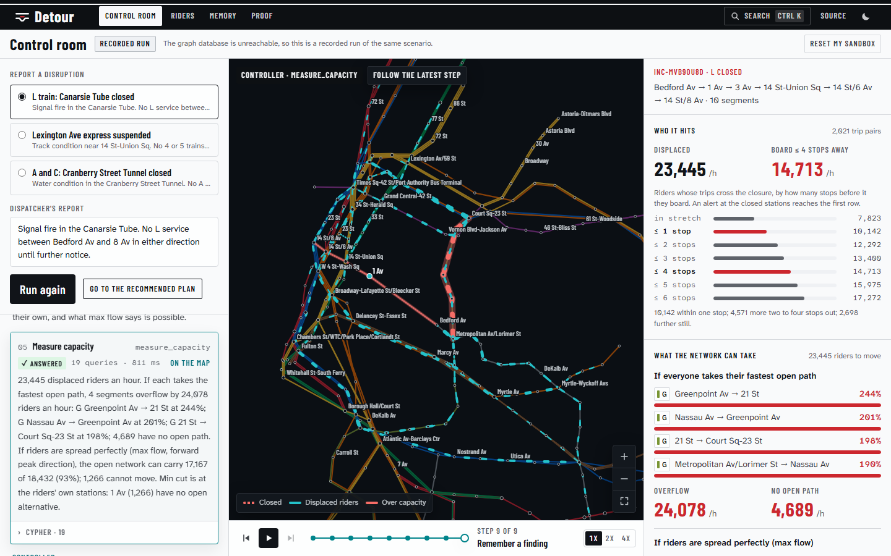
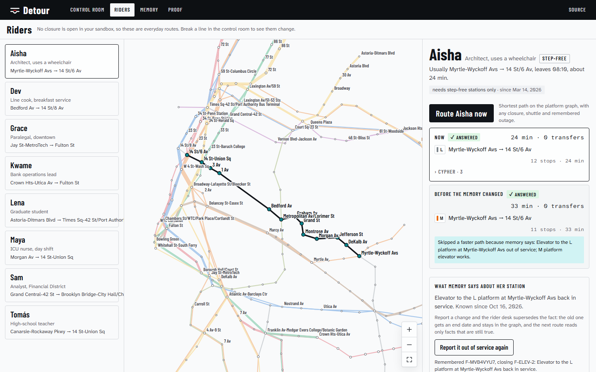
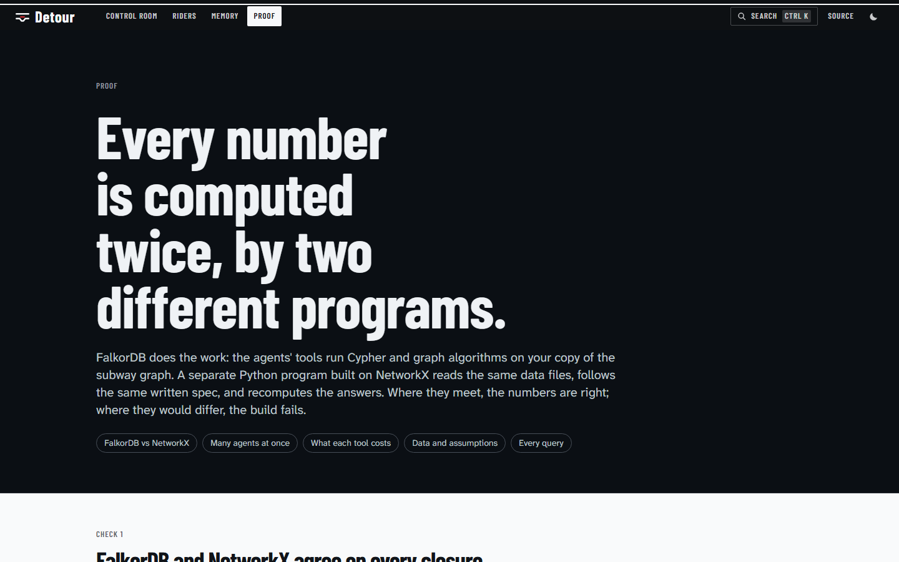

# Detour

**When a New York subway line breaks, Detour measures what the rest of the city can still carry.**

Agents work on a FalkorDB graph of the real subway, built from MTA open data. They find whose trips a closure breaks (including riders four stops away who never see it), measure what the open network can absorb with `algo.maxFlow` and name the bottleneck (min cut), test shuttle-bus plans on forked copies of the graph, and after a person approves, tell every remembered rider what to take instead. Memory lives in the same graph: facts carry dates, and a fact that stops being true is closed, not deleted, so it changes the next answer.

- **Live:** https://detour-orpin.vercel.app ([control room](https://detour-orpin.vercel.app/control?scenario=l-canarsie&run=1) · [riders](https://detour-orpin.vercel.app/riders?rider=aisha) · [memory](https://detour-orpin.vercel.app/memory) · [proof](https://detour-orpin.vercel.app/proof))
- **Tracks:** 1, Agents That Act on Connected Data (primary) · 2, Agent Memory and Coordination
- **MCP:** `https://detour-orpin.vercel.app/api/mcp` (Streamable HTTP; see [Use it from an agent](#use-it-from-an-agent))



## What it finds on the L train

Close the L between Bedford Av and 8 Av at 8 a.m. on a weekday. Every number below comes from tool calls on FalkorDB and is recomputed by an independent NetworkX program.

| | |
|---|---|
| Riders an hour whose trips cross the closure | **23,445** (10,142 board within one stop of it; 14,713 within four) |
| Where they go if nobody steers them | 4 G segments run at **190 to 244%** of capacity; 4,689 have no open path |
| What the open network can carry if riders are spread perfectly (max flow) | **17,167 of 18,432** toward Manhattan (93%) |
| The bottleneck (min cut) | **1 Av**: its only rail links are the closed L, so no spare capacity elsewhere reaches its riders |
| Shuttle 1 Av ↔ Astor Pl, tested on a fork | riders with no path 4,689 → 623; max-flow shortfall 1,266 → 315 |
| Memory that changed the plan | the June bus bridge carried 79% of plan, so the controller adds 27% more buses |

The Lexington express and Cranberry Street Tunnel closures come out differently: the open network absorbs everyone, so the controller proposes steering riders with no buses at all.

## How it works

```
 dispatcher ──► controller agent ──┐                     ┌── rider agents (one per affected rider)
                (Gemini → Groq,    │   fixed tool        │     route on the platform graph,
                 or its procedure  ├──► catalogue ──────►├──   write an advisory to the graph
                 as code)          │   (13 tools,        │
 approval ◄── plans, brief ◄───────┘    83 queries)      └── handoff through the graph
                                          │
                                          ▼
   FalkorDB   detour:template   the network, platform layer and seeded memory (never written by visitors)
              detour:demand     30,205 origin-destination flows with their 8 a.m. paths (shared, read-only)
              detour:sbx:<you>  GRAPH.COPY of the template per visitor: your closures, plans, memory
              detour:fork:…     throwaway copies per what-if: closure applied, flow network built, plan tested
```

- **The model never writes Cypher.** It picks from a fixed catalogue of typed tools. Each returns one of four answer shapes (answered, from memory, not in the graph, unknown name), a one-line summary, the data, and the exact queries it ran with their timings, which the control room shows step by step.
- **Three run modes, labeled in the interface.** *Live*: a free model (Gemini, then Groq) chooses the tools. *Scripted*: when the free quota is spent, the controller's procedure runs as code with the same tools on your graph. *Recorded*: when the database is unreachable, a run recorded on FalkorDB plays back.
- **Every visitor gets a graph.** The first request copies the template into `detour:sbx:<visitor>`; what-if forks are copied from that and deleted after use.

## Why a graph

Each step is a graph question that a table or a vector store answers badly:

1. **Whose trips cross the break?** Demand edges carry the segment ids of their 8 a.m. path; stations upstream are found hop by hop over `RUNS`.
2. **What can the rest of the network carry?** `algo.maxFlow` from a super source to a super sink over spare capacity, per direction of travel, on a fork without the closed segments. The min cut comes from the residual graph.
3. **Where do riders actually go?** `algo.SPpaths` over a platform layer (board, ride, alight, walk, bus) so waits and transfers are priced the way the baseline assignment prices them.
4. **What did we learn last time?** Findings hang off the same `Station` and `Route` nodes, so recall is a match from the stations an agent is about to touch.

## Graph data model

**Network** (`detour:template`, copied per visitor)

```
(:Station {id, name, label, lat, lon, loc, borough, ada, routes, entries})
(:Route {id, short, longName, color})-[:SERVES]->(:Station)
(:Station)-[:RUNS {eid, route, tph, minutes, baseMinutes, capacity, load, spare, closed}]->(:Station)   1,459 scheduled segments
(:Station)-[:WALK {wid, meters, minutes, capacity, spare}]->(:Station)                                   190 links under 400 m
(:Station)-[:BOARD {minutes}]->(:Platform {id, station, route})                 minutes = 3 + half the headway
(:Platform)-[:RIDE {eid, minutes, closed}]->(:Platform)-[:ALIGHT {minutes: 0}]->(:Station)
(:Station)-[:BUS {bid, plan, capacity, minutes, busesPerHour}]->(:Station)     published shuttle legs
```

**Demand** (`detour:demand`, shared and read-only)

```
(:Station)-[:DEMAND {riders, minutes, via: [eid], walks: [wid]}]->(:Station)   30,205 pairs, 404,040 of 446,230 riders at 8 a.m.
```

**Memory and coordination** (in each sandbox)

```
(:Agent)-[:WROTE]->(:Finding {id, text, kind, confidence, validFromMs, validToMs})-[:ABOUT]->(:Station | :Route)
(:Finding)-[:SUPERSEDES]->(:Finding)          a changed fact gets an end date and a successor
(:Finding)-[:FROM]->(:Incident)
(:Agent)-[:OPENED]->(:Incident {id, routes, stretch, closedEids, status, displaced, overflow, stranded, required, absorbed, unmet})-[:CLOSES]->(:Station)
(:Agent)-[:ACTED]->(:Episode {tool, outcome, summary, queries, ms, atMs})-[:IN]->(:Incident)
(:Agent)-[:PROPOSED]->(:Plan {id, legs, vehicles, strandedBefore, strandedAfter, unmetBefore, unmetAfter, …})-[:FOR]->(:Incident)
(:Agent)-[:HANDED_OFF {plan, incident, note, atMs}]->(:Agent)
(:Shuttle {busesPerHour, planned, observed})-[:FOR]->(:Incident)
(:Playbook {title, steps, uses, lastUsedMs})-[:FOR]->(:Route)
(:Rider {id, name, persona, stepFree, usualEids})-[:STARTS_AT|ENDS_AT]->(:Station)
(:Rider)-[:PREFERS {validFromMs, validToMs}]->(:Preference {key, value})
(:Agent)-[:WROTE]->(:Advisory {text, minutes, route, stepFree, atMs})-[:FOR]->(:Rider)
```

Forks add `(:Hub {id: 'SRC_F' | 'SNK_F' | …})` and `FLOW {kind, spare, refs}` edges: spare capacity summed per corridor, because `algo.maxFlow` takes one relationship type and no parallel edges. The full spec both implementations follow is [docs/model.md](docs/model.md).

## The queries it depends on

All 83 queries and graph commands are listed with their labels on the [proof page](https://detour-orpin.vercel.app/proof#cypher). The ones that do the reasoning:

```cypher
// Whose trips cross the closure (demand graph)
MATCH (o:Station)-[d:DEMAND]->(x:Station)
WHERE any(e IN d.via WHERE e IN $closed)
RETURN o.id AS o, x.id AS d, d.riders AS riders, d.via AS via

// Stations k stops upstream, one hop per query (variable-length paths over parallel edges time out)
MATCH (o:Station)-[:RUNS]->(t:Station)
WHERE t.id IN $frontier AND NOT o.id IN $seen
RETURN DISTINCT o.id AS id

// A what-if fork per call
GRAPH.COPY detour:sbx:<visitor> detour:fork:<visitor>:<label>

// Spare capacity per corridor, then max flow on the fork
MATCH (a:Station)-[r]->(b:Station) WHERE type(r) IN $kinds
WITH a, b, sum(r.spare) AS spare,
     collect(CASE type(r) WHEN 'RUNS' THEN 'R' + toString(r.eid) WHEN 'WALK' THEN 'W' + toString(r.wid) ELSE 'B' + toString(r.bid) END) AS refs
CREATE (a)-[:FLOW {spare: spare, kind: 'NET', refs: refs}]->(b)

MATCH (src:Hub {id: $src}), (snk:Hub {id: $snk})
CALL algo.maxFlow({sourceNodes: [src], targetNodes: [snk], relationshipTypes: ['FLOW'], capacityProperty: 'spare'})
YIELD maxFlow, edges, edgeFlows
RETURN maxFlow, [e IN edges | [e.kind, startNode(e).id, endNode(e).id]] AS es, edgeFlows AS flows

// Every displaced pair on its fastest open path, in one query
UNWIND $pairs AS p
MATCH (a:Station {id: p.o}), (b:Station {id: p.d})
CALL algo.SPpaths({sourceNode: a, targetNode: b, relTypes: ['BOARD', 'RIDE', 'ALIGHT', 'WALK', 'BUS'], weightProp: 'minutes'})
YIELD path, pathWeight
RETURN p.o AS o, p.d AS d, pathWeight AS minutes,
       [r IN relationships(path) WHERE type(r) = 'RIDE' | r.eid] AS eids

// Memory: recall from the stations and routes an agent is about to touch
MATCH (f:Finding)-[:ABOUT]->(n)
WHERE (n:Station AND n.id IN $stations) OR (n:Route AND n.id IN $routes)
WITH DISTINCT f
OPTIONAL MATCH (f)-[:FROM]->(i:Incident)
RETURN f.id AS id, f.text AS text, f.validFromMs AS validFromMs, f.validToMs AS validToMs, i.id AS incident

// Memory: a fact that stopped being true is closed and linked to its successor
MATCH (old:Finding {id: $old}), (f:Finding {id: $id})
WHERE old.validToMs IS NULL
SET old.validToMs = timestamp()
CREATE (f)-[:SUPERSEDES]->(old)
```

## Track 2: memory you can watch change an answer

On the [riders page](https://detour-orpin.vercel.app/riders?rider=aisha), Aisha uses a wheelchair. Memory says the elevator to the L platform at Myrtle-Wyckoff Avs has been out since Oct 14, so her step-free route skips the faster L and takes the M (33 min). Report the elevator fixed: the rider desk writes a new finding that supersedes the outage (the old one gets an end date and stays queryable), and her next route is the L (24 min).



- **Episodic:** every tool call becomes an `Episode` linked to its incident ([memory page](https://detour-orpin.vercel.app/memory)).
- **Semantic, with time:** findings carry `validFromMs`/`validToMs` and provenance (who wrote it, from which incident).
- **Procedural:** playbooks per route; past shuttles keep planned against observed riders, and the controller sizes new bus plans by the worst ratio it remembers.
- **Shared state and handoffs:** approval writes `HANDED_OFF` from the controller to the rider desk, which runs one agent per affected rider concurrently.
- **Per tenant, under load:** one graph per visitor. 48 reader and 6 writer agents across 6 tenant graphs sustained 7,195 reads and 719 writes a second (p95 15.5 ms and 17.1 ms), 0 errors, and a closure in one tenant was invisible in the other five.

## Proof

| Check | Result |
|---|---|
| Max flow, FalkorDB `algo.maxFlow` vs NetworkX Edmonds-Karp | agree in all 6 direction groups of the 3 closures |
| Riders hit by distance from the L closure | agree at every depth, 0 to 6 stops |
| Closed segments per scenario | identical sets |
| Concurrency (FalkorDB 4.22.1) | 7,195 reads/s and 719 writes/s, 0 errors, tenant isolation held |
| Unit and end-to-end tests | 18 Vitest tests (including the control room's state on recorded runs); 8 Playwright tests on desktop and phone |
| Lighthouse, mobile (home, control room, proof) | performance 98 to 99; accessibility, best practices and SEO 100 |



## Use it from an agent

The same tools are served over MCP. `assess_closure` runs on a private copy of the graph, so clients never see each other's closures.

```bash
claude mcp add --transport http detour https://detour-orpin.vercel.app/api/mcp
```

Tools: `resolve_places`, `route_trip` (with `step_free`), `recall_memory`, `assess_closure` (routes and two station ids, optional shuttle legs; about 4 seconds).

## Run it locally

Requirements: Node 22+, pnpm 11, a FalkorDB instance (FalkorDB Cloud's free tier, or `docker run -p 6379:6379 falkordb/falkordb`), and optionally a free Gemini or Groq key.

```bash
pnpm install
cp .env.example .env.local     # set FALKORDB_URL; add GOOGLE_GENERATIVE_AI_API_KEY or GROQ_API_KEY for live agents
pnpm seed                      # loads the network, demand and memory into FalkorDB (about a second)
pnpm dev                       # http://localhost:3000
```

The built network is committed in `data/nyc/`. To rebuild it from MTA sources: `pnpm fetch:data && pnpm build:data`.

| Command | What it checks |
|---|---|
| `pnpm typecheck && pnpm lint && pnpm test` | types, lint, unit tests |
| `pnpm test:e2e` | Playwright on desktop and phone (set `BASE_URL` to test a deployment) |
| `pnpm verify` | the NetworkX verifier (needs [uv](https://docs.astral.sh/uv/)) |
| `pnpm ci:scenarios` | every tool on all three closures against FalkorDB, compared with NetworkX |
| `pnpm ci:bench` | the concurrency and tenant-isolation benchmark |

Stack: Next.js 16 (App Router, Cache Components), React 19, Tailwind 4, TypeScript, FalkorDB 4.22 via `falkordb` 6.8, Vercel AI SDK 7 with Gemini and Groq, `mcp-handler`. Deployed on Vercel.

## Data

[MTA GTFS static](http://web.mta.info/developers/data/nyct/subway/google_transit.zip) (weekday trains departing 08:00 to 08:59 give trains per hour and capacity), [MTA Subway Stations](https://data.ny.gov/d/39hk-dx4f) and [Stations and Complexes](https://data.ny.gov/d/5f5g-n3cz) (accessibility), and the [MTA Subway Origin-Destination Ridership Estimate: 2025](https://data.ny.gov/d/y2qv-fytt) (a Wednesday in October 2025, 8 a.m.). Assumptions are listed on the [proof page](https://detour-orpin.vercel.app/proof#data). The remembered riders, past incidents and playbooks are example data and labeled as such. Detour is not affiliated with the MTA.

## AI assistance

This project was built with Claude Code (Anthropic's coding agent) as a pair programmer: it wrote much of the code, tests and documentation under my direction, following the research, product and design decisions recorded in [MISSILE.md](MISSILE.md), [PRODUCT.md](PRODUCT.md) and [DESIGN.md](DESIGN.md). At runtime the agents use free-tier Gemini and Groq models. The graph model, queries and architecture are documented above, and every number the agents report is checked by the NetworkX verifier rather than by a language model.
